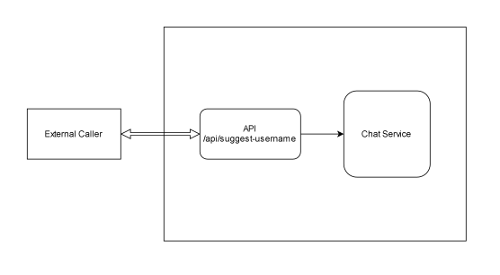

# hurdle-task #3 – FastAPI AI Microservice

Hurdle task for NagaEd screening.  

Name - Vikibe K Sumi  
Ph - +91 7629998601  
Email - vikibesumi3010@gmail.com  

## Tools 
- Python
- FastAPI
- Groq
- OpenAI
- Langchain

## Setup

1. Clone
```bash
git clone https://github.com/VikibeKSumi/hurdle-task.git
cd hurdle-task
```

2. Setup '.env' in root
```
GROQ_API_KEY=
```

3. Quick run
```python
python -m venv venv
venv\Scripts\activate
python -m pip install -r requirements.txt
python -m uvicorn app:app --port 8000
```

## System diagram


| Legend | Meaning |
| --- | --- |
| Parallel line | Http request |
| Plain line | Call flow |
## Non goals
- No memory
- No multi-turn chat

